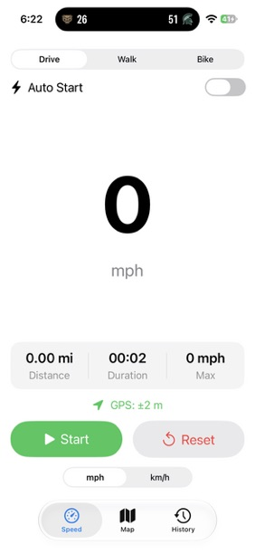

# iOS Speedometer

A GPS speedometer and trip computer for iPhone, built with SwiftUI, CoreLocation, MapKit, and HealthKit. Mount your phone on the dash for a big, glanceable speed readout — or take it on a walk or bike ride and save the workout, route and all, to Apple Health.

  

## Features

- **Live speed** — large rounded-font readout driven directly by GPS (`CLLocation.speed`), with smooth numeric transitions
- **Activity types** — Drive, Walk, or Bike, each tuning CoreLocation appropriately (automotive vs. fitness mode, jitter thresholds)
- **Auto start/stop** — optionally arm the app to begin a trip once you start moving and end it after you stop, with movement thresholds tuned per activity
- **Trip distance** — accumulated between GPS fixes with accuracy filtering (ignores jitter, rejects GPS "teleports" whose implied speed is impossibly fast for the activity, and drops fixes worse than ±50 m)
- **Trip duration** — running clock that correctly accumulates across pause/resume
- **Max speed** — high-water mark for the current trip, clamped to a plausible per-activity bound so one bad fix can't set a bogus record
- **Interactive route map** — MapKit view that draws your route as a live polyline, with a start flag, user-location dot, compass, and scale bar
- **Trip history** — completed trips are saved locally (SwiftData) and browsable on a History tab, each with its own route map and stats
- **Save to Apple Health** — completed walks and bike rides can be saved as HealthKit workouts with distance, duration, and the full GPS route; they appear in the Fitness app like any other workout (drives are excluded by design). Auto-ended fitness trips are saved automatically
- **mph / km/h toggle** — preference persists between launches
- **GPS accuracy indicator** — green when the fix is solid, orange while settling
- **Screen stays awake** while the app is open, for dash-mounted use

## Requirements

- Xcode 26 or later
- iOS 17.0+ (uses the SwiftUI MapKit APIs: `Map`, `MapPolyline`, `UserAnnotation`)
- A physical iPhone for real GPS and HealthKit testing (the Simulator can fake movement via **Features > Location > Freeway Drive**, but Health data is best verified on-device)

## Building

1. Clone the repo and open `Speedometer.xcodeproj` in Xcode
2. Select the Speedometer target > **Signing & Capabilities** and choose your own team
3. Build and run on your device (Cmd+R)

The project is already configured with:

- The **HealthKit capability**
- `NSLocationWhenInUseUsageDescription` (location permission)
- `NSHealthUpdateUsageDescription` and `NSHealthShareUsageDescription` (Health permissions)

On first launch, allow location access. The Health permission sheet appears the first time you save a workout.

## How it works

All logic lives in a single file, `Speedometer/SpeedometerApp.swift`:

- `TripManager` — an `ObservableObject` wrapping `CLLocationManager`. Publishes live speed and accuracy, and while tracking, accumulates distance between consecutive fixes, records timestamped route locations, and tracks max speed. Negative (invalid) GPS speed values are clamped to zero. Session start/end times are kept for HealthKit. When auto-stop fires, `finishTripAndReset()` owns the end-of-trip flow — saving to history, auto-saving fitness trips to Health, and resetting — so it works no matter which tab is on screen (the app injects the SwiftData and HealthKit side effects as closures).
- `HealthManager` — saves a completed trip via `HKWorkoutBuilder` (workout type, distance sample, start/end) and attaches the GPS route with `HKWorkoutRouteBuilder`. Walks save as `.walking` with `distanceWalkingRunning`; rides as `.cycling` with `distanceCycling`.
- `TripRecord` — a SwiftData `@Model` persisting each completed trip (activity, distance, duration, max speed, and the encoded route) for the History tab.
- `SpeedView` — the main gauge tab: activity picker, auto-start toggle, speed readout, stats card (distance / duration / max), start–pause–reset controls, Save to Health button, and unit picker.
- `TripMapView` — the map tab: route polyline, start marker, and a floating stats capsule, updated live.
- `HistoryView` / `TripDetailView` — the History tab: a list of saved trips, each opening to its route map and stat cards.

Tracking uses when-in-use location only, so recording pauses if the app is backgrounded or the screen locks — fine for dash-mounted driving, a known limitation for pocketed walks (see roadmap).

## Known limitations

- Pause/resume within a trip saves to Health as one continuous workout (paused time counts as workout time)
- No background tracking yet — the app must stay in the foreground to record

## Roadmap

- Background tracking (Always permission + location background mode)
- Proper pause/resume events in saved HealthKit workouts
- HUD mode (mirrored display for windshield reflection)
- Average speed and moving time vs. stopped time

## License

See [LICENSE](LICENSE).
